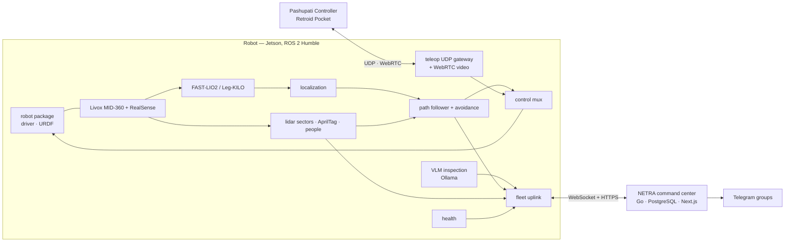

<div align="center">


# Pashupati

**Autonomous patrol and inspection stack for quadruped robots, legged or wheel-legged, of any
brand with a ROS 2 driver: LiDAR-inertial teach and repeat, obstacle avoidance by path shift,
on-robot AI inspection, crowd sensing, a handheld controller and the NETRA command center.**

[](https://github.com/DarmawanRobotics/Pashupati/actions/workflows/ci.yml)
[](https://docs.ros.org/en/humble/)
[](https://releases.ubuntu.com/22.04/)


[](LICENSE)
[](docs/README.md)

[Features](#features) · [System](#system) · [Install](#install) · [Workflow](#workflow) ·
[Operations](#operations) · [Develop](#develop) · [Docs](docs/README.md)

</div>

---

Mall corridors are patrolled on fixed routes every shift. Pashupati therefore uses **teach and
repeat** instead of a global planner: drive a route once, and the robot repeats it on schedule,
inspecting the floor and counting people along the way. Everything runs on the robot as one
supervised service. The [Pashupati Controller](https://github.com/DarmawanRobotics/PashupatiController)
handheld and NETRA connect to it over the network.

**Guides:** the [User Manual](docs/Pashupati-User-Manual.pdf) for operators and the
[Tuning Guide](docs/Pashupati-Tuning-Guide.pdf) for technicians, as PDFs that read well on a
phone. More in [docs](docs/README.md).

## Features

**Teach**
- Drive the robot once, from the handheld or RViz, while FAST-LIO2 (or Leg-KILO) tracks it.
- Mark inspection stops along the way.
- Record the AprilTags that anchor the map, so a route lines up again wherever the robot is
  started.
- When recording ends, the route is uploaded to NETRA.

**Repeat**
- Routes are resampled and smoothed, then followed with a curvature-aware speed profile.
- The default controller uses all three axes of a legged robot: it closes errors sideways,
  strafes or backs up, and keeps its heading along the route.
- The robot can join a route from beside it. A route loaded again starts over.
- At every stop the robot converges to 5 cm and 3°, inspects, then moves on.
- Looping patrols end their lap on low battery.

**Stay safe**
- Obstacles are passed by sliding sideways within a bounded offset from the route (path shift).
  When there is no gap, the robot stops short.
- A 360° protective field caps every command at a speed the robot can still stop at.
- The software e-stop is latched in the control mux.
- Navigation stops when odometry or the safety scan goes stale.

**Inspect**
- A local vision-language model runs through Ollama: qwen3-vl by default, moondream or any other
  vision model, switched live.
- Three paces:
  - *continuous*: frames back to back;
  - *interval*: a frame every 0.1 s to 5 min, waiting in a first-in-first-out queue that survives
    restarts;
  - *stop points only*.
- Own finding types, each with a description of what to look for, are added from the handheld.
  Each type is either reported or only shown.
- Findings go to NETRA with their evidence frame and the pose where the frame was taken.

**Count people**
- YOLO11n (ONNX, no PyTorch) runs on the GPU when available, 5 times a second; on the CPU it runs
  twice a second.
- People are boxed on the handheld video, placed on the floor plan, and aggregated into per-minute
  crowd heatmaps for NETRA.

**Operate**
- [Pashupati Controller](https://github.com/DarmawanRobotics/PashupatiController) on a Retroid
  Pocket: drive, WebRTC video, map and routes, patrol control, inspection settings, and the
  robot's CPU, GPU and RAM.
- NETRA: schedules, live telemetry, alerts and Telegram.
- On the robot: one systemd service with respawning nodes, health monitoring, and uploads spooled
  while offline.

## System



| Repository | |
|---|---|
| **Pashupati** (this) | the robot workspace |
| [PashupatiController](https://github.com/DarmawanRobotics/PashupatiController) | handheld app (Retroid Pocket / Android) |
| robot package | the robot's driver, URDF and sensor launch, under `src/xtras/robots/` ([contract](src/xtras/README.md)) |
| [`leg_kilo`](src/xtras/slam/leg_kilo) | Leg-KILO odometry, `pashupati` branch of the fork (submodule, optional) |
| NETRA | command center: backend, dashboard, deployment |

<details>
<summary><b>Hardware</b></summary>

| Component | Model | Role |
|---|---|---|
| Robot base | any quadruped (legged or wheel-legged) with a ROS 2 driver | robot package, [contract](src/xtras/README.md) |
| LiDAR | Livox **MID-360** | FAST-LIO2 odometry, obstacle sectors, handheld lidar view |
| Camera | Intel RealSense **D435i** | AprilTags, VLM inspection, people, handheld video |
| Compute | NVIDIA **Jetson Orin NX** (JetPack 6) | ROS 2 Humble, Ollama, ONNX Runtime, hardware H.264 |

</details>

<details>
<summary><b>Packages</b></summary>

| Package | Role |
|---|---|
| [`dharma_interfaces`](src/dharma_interfaces) | messages and services |
| [`dharma_odometry`](src/dharma_odometry) | LiDAR-inertial odometry (FAST-LIO2 or Leg-KILO), stillness gate, odometry monitor, route recording |
| [`dharma_localization`](src/dharma_localization) | FAST-LIO frame bridge, `map→odom` from AprilTags / RViz, tag recording |
| [`pashupati_inspection`](src/pashupati_inspection) | LiDAR sectors, AprilTag, person detection (YOLO11n ONNX) |
| [`dharma_navigation`](src/dharma_navigation) | route processing, 5 controllers, 4 avoidance algorithms, final approach, safety |
| [`pashupati_bridge`](src/pashupati_bridge) | AUTO / REMOTE control mux, UDP teleop gateway ([protocol](src/pashupati_bridge/PROTOCOL.md)), WebRTC video |
| [`pashupati_fleet`](src/pashupati_fleet) | NETRA uplink: telemetry, events, crowd, anomalies, routes ([API](src/pashupati_fleet/API.md)) |
| [`pashupati_inspection`](src/pashupati_inspection) | VLM inspection (Ollama): continuous, interval queue or stop points, own finding types |
| [`pashupati_health`](src/pashupati_health) | node liveness, odometry / safety scan / e-stop state, sensor rates, CPU, GPU and RAM |
| [`pashupati_rviz`](src/pashupati_rviz) | RViz panels: Mission, Status, Tuning, AprilTags |
| [`pashupati`](src/pashupati) | the robot: one launch with respawning nodes, site configuration |
| [`pashupati_sim`](src/pashupati_sim) | simulated quadruped (driver, LiDAR, FAST-LIO interfaces) for the whole stack, end-to-end test |

</details>

## Install

You need Ubuntu 22.04 with ROS 2 Humble (JetPack 6 on a Jetson), internet access, and the robot's
SSH key added to GitHub.

```bash
git clone --recursive git@github.com:DarmawanRobotics/Pashupati.git ~/dev/Pashupati
cd ~/dev/Pashupati
git clone <robot package repo> src/xtras/robots/<name>   # driver + URDF + sensors, src/xtras/README.md
script/setup.sh install config          # creates /etc/pashupati/pashupati.env and site.yaml
sudoedit /etc/pashupati/pashupati.env   # ROBOT_BRINGUP, ROBOT_NS, ROBOT_SETUP, ROBOT_PRESTART, ROUTE, TAGS
sudoedit /etc/pashupati/site.yaml       # this robot: footprint, speeds, teleop token, robot_commands
script/setup.sh install                 # everything missing, then the build
script/setup.sh install service         # systemd unit, enabled at boot
sudo systemctl start pashupati && journalctl -fu pashupati
script/setup.sh                         # every line ok?
```

**Update.** Pull, rebuild and restart:

```bash
git pull && git submodule update --init --recursive \
  && script/setup.sh install build config service && sudo systemctl restart pashupati
```

`install build` rebuilds whenever the checkout has moved, `install config` adds env keys that are
new in the example, and `install service` rewrites an outdated unit.

### Configuration

- **`/etc/pashupati/pashupati.env`** describes the deployment: robot package, namespace, mode,
  route, NETRA. systemd, bash and `script/setup.sh` all read it. Quote any value with spaces
  (`ROBOT_PRESTART="robot-launch stop x"`), and never put a comment after a value.
- **`/etc/pashupati/site.yaml`** sets the parameters of this robot and site, on top of every
  package default ([example](src/pashupati/config/site.example.yaml)). It only needs a restart,
  not a rebuild. Set the same teleop `token` in the handheld. The
  [Tuning Guide](docs/Pashupati-Tuning-Guide.pdf) explains every parameter.
- **Vendor stacks.** Pashupati runs on `rmw_fastrtps_cpp`, domain 0. A vendor autostart that also
  drives the robot or its LiDAR is stopped by `ROBOT_PRESTART` before every start.
- **ROS stays on the robot** (`ROS_LOCALHOST_ONLY=1`), so nothing on the Wi-Fi can bypass the
  control mux. Set it to 0 only to debug with RViz on a laptop.

| Extra | `pashupati.env` | Install | Gives |
|---|---|---|---|
| Handheld video | `WEBRTC=true` | `script/setup.sh install webrtc` | H.264 over WebRTC through MediaMTX (TCP 8890, UDP 8190), encoded only while watched; JPEG without it |
| AI inspection | `INSPECTION=true` | `script/setup.sh install ollama` | VLM inspection; also turns off Ollama's prompt cache, which would otherwise hold up to 8 GiB of RAM |
| People | `PEOPLE=true` | `script/setup.sh install people_model` | YOLO11n ONNX model and ONNX Runtime, no PyTorch |
| NETRA | `CC_URL`, `CC_TOKEN`, `ROBOT_ID` | — | telemetry, findings, routes, remote commands |

You can also switch inspection and people detection on and off live from the handheld. The robot
remembers the choice across restarts.

**A shell on the robot** needs the service's environment; otherwise `ros2 topic list` shows
nothing, or only the vendor's topics:

```bash
echo "alias pashu='source ~/dev/Pashupati/script/env.sh'" >> ~/.bashrc   # once
pashu
ros2 topic hz /perception/safety_scan
pnode pashupati_bridge teleop_udp_node bridge_params.yaml   # one node, as robot.launch.py runs it
```

<details>
<summary><b>Troubleshooting</b></summary>

| Symptom | Cause | Fix |
|---|---|---|
| `-bash: stop: command not found` when loading the env | value with spaces not quoted | quote it; `script/setup.sh` shows the line |
| `ros2 topic list` empty or only vendor topics | shell on another RMW, domain or `ROS_LOCALHOST_ONLY` | `pashu` (`script/env.sh`, it also restarts the ros2 daemon) |
| RViz on a laptop sees no topics | `ROS_LOCALHOST_ONLY=1` | set 0 in the env file while debugging, restart the service |
| robot or LiDAR also driven by the vendor stack | vendor autostart | `ROBOT_PRESTART` |
| camera drops out, udev and journal flooded every second | kernel `uvcvideo` and librealsense both bind the camera | `script/setup.sh install realsense` (blacklists `uvcvideo` on Jetson), reboot |
| camera works with `ros2 run`, but the service logs "No RealSense devices were found!" | the shell has a source-built librealsense first in `LD_LIBRARY_PATH`, the service uses the apt one | `LD_LIBRARY_PATH_FIRST=/usr/local/lib` in `pashupati.env`, restart |
| odometry fails or TF is stale right after boot; NETRA says the robot clock is off | no battery-backed clock: NTP steps the time minutes after the stack started | `timedatectl` must say synchronized; the stack waits `TIME_SYNC_WAIT` s for it |
| RAM nearly full with inspection on, `llama-server` at ~9 GB | Ollama's prompt cache in RAM | `script/setup.sh install ollama` |
| a Python node at 100-200 % CPU | numpy OpenBLAS threads busy-wait | `OPENBLAS_NUM_THREADS=1` (env file) |
| handheld: "wrong token" | app token differs from `teleop_udp_node.token` | same token in both |
| handheld connected, robot does not walk | mode AUTO, or the e-stop is latched | REMOTE on the handheld, release the e-stop |
| handheld video choppy, `WebRTC video off` in the journal | MediaMTX missing or older than v1.11 | `script/setup.sh install webrtc`, restart the service |
| `model ... is not installed in Ollama` | model pulled into `~/.ollama`, not into the service | `script/setup.sh install ollama` |
| `malformed launch argument 'route:='` | empty launch argument | leave it out; `robot.launch.py` reads the env |
| build killed (out of memory) | too many parallel compile jobs | `BUILD_WORKERS=1 BUILD_JOBS=2 script/setup.sh install build` |
| `apt-get update`: "no longer has a Release file" | a dead apt mirror (vendor images often use `mirrors.tuna.tsinghua.edu.cn`) | point `/etc/apt/sources.list*` at `ports.ubuntu.com/ubuntu-ports` (`archive.ubuntu.com/ubuntu` on x86) and `packages.ros.org/ros2/ubuntu` |

</details>

## Workflow

**Teach**

1. Start in teach mode (`MODE=teach` in the env file, or `script/start_tmux.sh teach`). Keep the
   robot still until odometry starts (`odometry/status` leaves `initializing`).
2. On the handheld, switch to **REMOTE**, tap **Record** and drive the route. Tap **Point**
   wherever the robot should stop and inspect. The RViz Mission panel, `route/record` and
   `route/mark_stop_point` work as well.
3. Stand still in view of each AprilTag and **Record Tag Poses** (AprilTags panel or
   `localization/record_tags`). Tags recorded in the same session anchor the same map frame.
4. Stop recording. The route is saved under `map/<date>/` and uploaded to NETRA. End near the
   start for a looping patrol.

**Repeat**

- **Localize** from a tag (handheld, panel or `localization/start`). Navigation refuses to start
  until `localization/status` reports a source.
- **Start** from NETRA (now, or on a weekly schedule), from the handheld (**Routes** → load →
  **Start**), or by hand:

```bash
ros2 service call /navigation/load_path dharma_interfaces/srv/LoadPath "{waypoints_file: '/home/robot/dev/Pashupati/map/<date>/<time>_path.csv'}"
ros2 service call /navigation/start_nav std_srvs/srv/SetBool "{data: true}"
```

- At every stop the robot converges, calls `/anomaly_detector_node/check_now`, dwells, and moves
  on. Anomalies, crowd windows and stop events flow to NETRA.

**Emergency stop.** The software e-stop is latched in the control mux. It can be engaged from:
- the handheld **STOP** (screen or gamepad B);
- NETRA;
- `ros2 service call /bridge/estop std_srvs/srv/SetBool "{data: true}"`.

While it is engaged, only zero velocity reaches the robot and navigation is paused. Releasing it
is explicit: `estop_release` from the handheld or NETRA, or `{data: false}`. Navigation then
stays paused until an operator resumes it. The driver's own stop is
`ros2 service call /<robot_ns>/emergency_stop std_srvs/srv/Trigger`.

<details>
<summary><b>Patrol behaviour</b></summary>

| Feature | What it does | Key parameters |
|---|---|---|
| Route processing | dedup, resample, gradient smoothing between stop points; stops never move | `resample_spacing`, `smooth_weight_*` |
| Controllers | `holonomic` (default: x, y and yaw, strafes and reverses, heading kept along the route), `pure_pursuit`, `pid`, `mppi`, `lqr`, `stanley`, switchable live | `controller`, `<controller>.*` |
| Speed profile | curvature speed cap, braking into stops and the route end | `max_lateral_accel`, `approach_speed` |
| Avoidance | path shift (default): slide sideways around obstacles on the 360° safety scan, never more than `max_offset` from the route, stop short without a gap; or reactive `braitenberg`, `vfh`, `potential_field`, `follow_gap` | `avoidance_mode`, `path_shift.*`, `algorithm` |
| Joining | starts from beside the route: walks onto it first, refuses when too far | `join_max_distance`, `join_timeout_sec` |
| Final approach | x / y / yaw convergence (strafing) to 5 cm / 3° | `holonomic`, `approach.*` |
| Inspection | VLM check at each stop, waits for the result, then dwells | `inspection_services`, `inspection_timeout_sec` |
| Loop patrol | restarts closed routes, ends the lap on low battery | `loop_route`, `low_battery_percentage` |
| Safety | stops on stale avoidance / odometry, e-stop hysteresis, `BLOCKED`, `OFF_PATH`, teleop watchdog | `*_timeout_sec`, `off_path_*` |
| Protective field | speed and separation monitoring in the mux, in every direction: v·t + v²/2a ≤ clearance − margin; no fresh 360° scan, no autonomous motion | `field.*`, `safety_scan_timeout_sec` |
| Control mux | AUTO (navigation) or REMOTE (handheld); REMOTE pauses navigation; zero when the active source goes silent; speed envelope, non-finite commands dropped | `bridge/set_mode`, `max_v*` |
| Software e-stop | latched in the mux: only zero reaches the robot until an explicit release, navigation stays paused | `bridge/estop` |
| Resilience | respawning nodes, supervised service, route remembered, uploads spooled offline | — |

Every navigation and avoidance parameter applies live (**Tuning** panel or `ros2 param set`); save
the tuned values with **Save YAML**.

</details>

## Operations

| | |
|---|---|
| Health | `ros2 topic echo /health/status`: `level` is ok, warn or error. It is error for a missing node, lost odometry, a stale safety scan or an engaged e-stop. It also reports sensor rates, CPU, GPU, RAM, temperature and disk, and is shown on the handheld and in NETRA |
| Inspection | `ros2 topic echo /anomaly_detector/status`: state, model, pace, queue, finding types and the last result |
| People | `ros2 topic echo /perception/people_status`: state, backend, count and boxes |
| Logs | `journalctl -fu pashupati`; ROS logs older than 7 days are pruned at start |
| Debug view | RViz `pashupati_rviz/rviz/robot.rviz`: route coloured by speed, lookahead, cross-track, avoidance cone, approach target, tags |

<details>
<summary><b>Services</b></summary>

| Service | Type | Node |
|---|---|---|
| `/route/record` | `std_srvs/SetBool` | route_recorder_node |
| `/route/mark_stop_point` | `dharma_interfaces/MarkStopPoint` | route_recorder_node |
| `/localization/start`, `/localization/record_tags` | `std_srvs/Trigger` | localization_node |
| `/navigation/load_path` | `dharma_interfaces/LoadPath` | path_loader_node |
| `/navigation/start_nav`, `/navigation/pause` | `std_srvs/SetBool` | path_follower_node |
| `/bridge/set_mode` | `dharma_interfaces/SetMode` | control_mux_node |
| `/bridge/estop` | `std_srvs/SetBool` (`true` engages, `false` releases) | control_mux_node |
| `/anomaly_detector_node/check_now` | `std_srvs/Trigger` | anomaly_detector_node |
| `/<robot_ns>/<command>` | `std_srvs/Trigger` | robot driver ([contract](src/xtras/README.md)) |

</details>

<details>
<summary><b>Topics</b></summary>

| Topic | Type | Publisher |
|---|---|---|
| `/<robot_ns>/cmd_vel` | `geometry_msgs/Twist` | control_mux_node |
| `/bridge/nav_cmd_vel`, `/bridge/remote_cmd_vel` | `geometry_msgs/Twist` | path_follower_node, teleop_udp_node |
| `/bridge/mode` | `std_msgs/String` (latched) | control_mux_node |
| `/bridge/estop_engaged`, `/bridge/estop_reason` | `std_msgs/Bool`, `std_msgs/String` (latched) | control_mux_node |
| `/bridge/estop_request` | `std_msgs/String` (reason) | any node: engages the e-stop |
| `/bridge/protective_field` | `std_msgs/String` (latched): `clear`, `limited`, `stop`, `stale`, `off` | control_mux_node |
| `/odometry/status` | `std_msgs/String` (latched) | odometry_monitor_node |
| `/odometry/restarted` | `std_msgs/Empty` | odometry_monitor_node |
| `/localization/status` | `std_msgs/String` (latched) | localization_node |
| `/navigation/waypoints` | `dharma_interfaces/WaypointPath` (latched) | path_loader_node |
| `/navigation/status`, `/navigation/mission_status`, `/navigation/stop_point_event` | dharma_interfaces | path_follower_node |
| `/navigation/markers`, `/navigation/route_markers`, `/navigation/avoidance_markers` | `MarkerArray` | navigation |
| `/perception/sector_scan` | `dharma_interfaces/SectorScan` | lidar_sector_node |
| `/perception/safety_scan` | `dharma_interfaces/SectorScan` (360°, all blocked when the LiDAR is blind) | lidar_sector_node |
| `/perception/people`, `/perception/people_status` | `geometry_msgs/PoseArray`, `std_msgs/String` (JSON, latched) | person_detector_node |
| `/anomaly_detector/result`, `/anomaly_detector/status` | `std_msgs/String` (JSON; status latched) | anomaly_detector_node |
| `/health/status` | `std_msgs/String` (JSON, latched) | health_monitor_node |
| `/route/saved` | `std_msgs/String` | route_recorder_node |

</details>

<details>
<summary><b>TF tree</b></summary>

```
map → odom → camera_init → body → base_link ─┬─ livox_frame → livox_imu_frame
 (localization_node)  (FAST-LIO2)  (bridge)   └─ camera_link → camera_*_optical_frame
```

`camera_init → body` comes from FAST-LIO2 or Leg-KILO (`odometry:=leg_kilo`), same frame names.

</details>

<details>
<summary><b>File formats</b></summary>

**Route CSV**: `x, y, yaw_deg, dwell_sec` in the `map` frame; `dwell_sec > 0` is an inspection stop.

```csv
# x,y,yaw_deg,dwell_sec
0.0,0.0,0,0
2.0,0.5,45,10.0
```

**Tag config JSON**: map pose per AprilTag TF frame (written by `localization/record_tags`).

```json
{ "base_map": { "x": 0.0, "y": 0.0, "z": 0.8, "qx": 0.0, "qy": 0.0, "qz": 0.0, "qw": 1.0 } }
```

</details>

## Develop

**Dev container** (macOS / Linux):

```bash
script/dev.sh up      # Docker: ROS 2 Humble + all deps + XFCE desktop over VNC
script/dev.sh build   # colcon build (symlink-install, Release)
script/dev.sh test
script/dev.sh vnc     # TigerVNC localhost:5901 or http://localhost:6080/vnc.html
```

On the robot during development, `script/start_tmux.sh teach|patrol` opens one pane per part plus
RViz, with the package default parameters and the env file's settings.

**Simulation.** The whole stack runs against a simulated quadruped
([pashupati_sim](src/pashupati_sim)), with no robot, Gazebo or GPU:

```bash
ros2 launch pashupati_sim sim.launch.py autostart:=true rviz:=true
# a person steps onto the route
ros2 topic pub --once /sim/obstacles geometry_msgs/msg/PoseArray "{poses: [{position: {x: 2.0, y: -3.0}}]}"
```

The simulated robot localizes itself and patrols a loop with an inspection stop. It stops for the
person and drives on once they are gone. The handheld (token `sim`) and NETRA (`cc_url:=`)
connect to it as they would to a real robot.

**Tests.**

```bash
colcon test --executor sequential && colcon test-result --verbose
```

Every package runs flake8 and pep257 plus its own tests:
- Navigation simulations drive every controller around a noisy loop and an out-and-back corridor.
- In-process ROS tests drive the real teleop gateway over UDP, the inspection node against a fake
  Ollama, and the odometry and navigation nodes with fake sensors.
- An end-to-end test runs the whole stack in the simulator. The robot slides around a person on
  the route and still does the stop, stops for a crowd, and cannot be driven into a person from
  the handheld.

CI runs all of it on every push and pull request
([ci.yml](.github/workflows/ci.yml)), and failing tests show up as annotations. The people model
is exported and checked by its own workflow
([people-model.yml](.github/workflows/people-model.yml)). CI also builds the PDF guides
([docs](docs/README.md)). Branch and commit rules are in
[CONTRIBUTING.md](CONTRIBUTING.md), and changes are listed in [CHANGELOG.md](CHANGELOG.md).

```
Pashupati/
├── .github/workflows/            # ci.yml (build, tests, lint), people-model.yml
├── docker/ docker-compose.yaml   # dev container (VNC desktop, shared workspace)
├── docs/                         # User Manual and Tuning Guide (PDF + sources), logo
├── map/                          # recorded routes + example/
├── script/                       # setup.sh, run_robot.sh (service), env.sh (shell), start_tmux.sh, dev.sh
└── src/
    ├── robot_* pashupati         # first-party packages
    └── xtras/                    # submodules: livox_ros_driver2, FAST_LIO, Leg-KILO; robots/<your robot>
```

Pashupati is released under the [Apache License 2.0](LICENSE).
