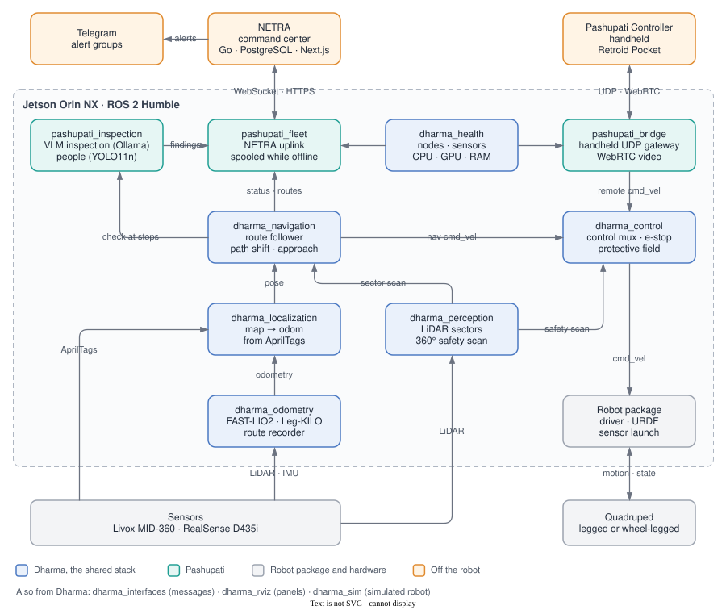

<div align="center">


# Pashupati

**Autonomous patrol and inspection robot for quadrupeds, legged or wheel-legged, of any brand
with a ROS 2 driver: teach and repeat on mapped sites, VLM inspection at stop points, crowd
sensing, a handheld controller and the NETRA command center. Built on the Dharma stack.**

[](https://github.com/DarmawanRobotics/Pashupati/actions/workflows/ci.yml)
[](docs/README.md)
[](https://docs.ros.org/en/humble/)
[](https://releases.ubuntu.com/22.04/)
[](pashupati.repos)
[](compose.yaml)


[](LICENSE)

[Packages](#packages) · [Architecture](#architecture) · [Quick start](#quick-start) ·
[Simulation](#simulation) · [Install on the robot](#install-on-the-robot) ·
[Operate](#operate) · [Develop](#develop) · [Docs](docs/README.md)

</div>

---

Mall corridors are patrolled on fixed routes every shift. Pashupati therefore works by **teach
and repeat**: map a site once, drive a route with its stop points, and the robot repeats it on
schedule, inspecting the floor with a vision-language model and counting people along the way.
Everything runs on the robot as one supervised service; the
[Pashupati Controller](https://github.com/DarmawanRobotics/PashupatiController) handheld and NETRA
connect to it over the network.

Pashupati runs on **Dharma** 0.2, the shared autonomy stack: odometry, localization, perception,
mapping and sites, the planner, path following, docking, the control mux and health come from
the `dharma_*` repositories, pinned in [pashupati.repos](pashupati.repos). This repository adds
what makes it a patrol robot (VLM inspection, people, the NETRA uplink, the handheld gateway) and
the bringup with the values tuned on the robot.

**Guides:** the [User Manual](docs/manual/user-manual.md) for operators and the
[Tuning Guide](docs/tuning/tuning-guide.md) for technicians. More in [docs](docs/README.md).

## Packages

| Package                                            | Role                                                                                                            |
| -------------------------------------------------- | --------------------------------------------------------------------------------------------------------------- |
| [`pashupati`](src/pashupati)                       | the robot: profile, stack config, `robot.launch.py`, `sim.launch.py`, the end-to-end test                       |
| [`pashupati_inspection`](src/pashupati_inspection) | VLM inspection through Ollama (`anomaly_detector_node`), person detection with YOLO11n ONNX                     |
| [`pashupati_bridge`](src/pashupati_bridge)         | handheld gateway over UDP ([protocol](src/pashupati_bridge/PROTOCOL.md)), WebRTC video, RTSP camera source      |
| [`pashupati_fleet`](src/pashupati_fleet)           | NETRA uplink: telemetry, stop events, findings, crowd, routes ([API](src/pashupati_fleet/API.md)), `fake_netra` |
| [`pashupati_utils`](src/pashupati_utils)           | what the Pashupati packages share: typed status to protocol names, health figures, launch helpers               |
| `dharma_*` ([pashupati.repos](pashupati.repos))    | utils, interfaces, odometry, localization, perception, mapping, navigation, health, rviz, sim                   |

The robot's driver, URDF and sensors come from a robot package under `src/xtras/robots/`
([contract](src/xtras/README.md)); FAST-LIO2 and the Livox driver are submodules in `src/xtras/`.

## Architecture



<sub>[docs/diagrams/system.drawio.svg](docs/diagrams/system.drawio.svg): open it in draw.io, edit
and save, and this picture changes with it.</sub>

- **Motion has one way out.** `control_mux_node` is the only publisher of `/<robot_ns>/cmd_vel`.
  In AUTO it passes the follower and the planner; in REMOTE the handheld
  (`control/remote/handheld/cmd_vel`) or NETRA's dashboard. The protective field, the health speed
  limit and the latched e-stop apply to every source.
- **Patrol** is Dharma's path follower on a taught route of the active site. At each stop point
  it converges, calls the inspection hook (`/anomaly_detector_node/check_now`), dwells and moves
  on; a disabled or missing inspection never blocks the patrol.
- **Status is typed:** the Pashupati nodes read `ControlStatus`, `NavigationStatus`,
  `LocalizationStatus`, `HealthStatus`, `SiteStatus`, `StopPointEvent` and `DockingStatus`, and
  translate them for the handheld protocol v1 and the NETRA API, which keep their wire format.
- **Configuration** is layered: the robot profile ([robot.yaml](src/pashupati/config/robot.yaml)),
  the stack as tuned on the robot ([stack.yaml](src/pashupati/config/stack.yaml)), this robot's
  site file (`/etc/pashupati/site.yaml`), then launch arguments from `/etc/pashupati/pashupati.env`.

<details>
<summary><b>Hardware</b></summary>

| Component  | Model                                                      | Role                                               |
| ---------- | ---------------------------------------------------------- | -------------------------------------------------- |
| Robot base | any quadruped (legged or wheel-legged) with a ROS 2 driver | robot package, [contract](src/xtras/README.md)     |
| LiDAR      | Livox **MID-360**                                          | FAST-LIO2 odometry, mapping, sectors, safety scan  |
| Camera     | Intel RealSense **D435i**, or an RTSP camera               | AprilTags, VLM inspection, people, handheld video  |
| Compute    | NVIDIA **Jetson Orin NX** (JetPack 6)                      | ROS 2 Humble, Ollama, ONNX Runtime, hardware H.264 |

</details>

## Quick start

The dev container has ROS 2 Humble, every dependency and an XFCE desktop over VNC:

```bash
git clone --recursive git@github.com:DarmawanRobotics/Pashupati.git && cd Pashupati
scripts/dev.sh up      # build the image, import pashupati.repos into src/dharma, start
scripts/dev.sh build   # colcon build
scripts/dev.sh test    # colcon test
scripts/dev.sh vnc     # TigerVNC localhost:5901 or http://localhost:6080/vnc.html
```

Without Docker: Ubuntu 22.04 with ROS 2 Humble, then
`vcs import src < pashupati.repos`, `rosdep install --from-paths src --ignore-src -y` and
`colcon build`.

## Simulation

The whole robot runs on [dharma_sim](https://github.com/DarmawanRobotics/dharma_sim), with no
robot, Gazebo or GPU:

```bash
ros2 launch pashupati sim.launch.py rviz:=true
ros2 run pashupati_fleet fake_netra --port 8765 &       # a local NETRA
ros2 launch pashupati sim.launch.py cc_url:=http://127.0.0.1:8765 inspection:=true
scripts/start_tmux.sh sim                                  # both, plus a status pane
```

The simulated robot starts on the `mall_loop` site (in `/tmp/pashupati_sim/sites`) and
localizes itself; teach a route and patrol it with the commands under [Operate](#operate). The
handheld connects with the token `sim`.

## Install on the robot

You need Ubuntu 22.04 with ROS 2 Humble (JetPack 6 on a Jetson), internet access, and the robot's
SSH key added to GitHub with read access to the `dharma_*` repositories.

```bash
git clone --recursive git@github.com:DarmawanRobotics/Pashupati.git ~/dev/Pashupati
cd ~/dev/Pashupati
git clone <robot package repo> src/xtras/robots/<name>   # driver + URDF + sensors, src/xtras/README.md
scripts/setup.sh install config          # creates /etc/pashupati/pashupati.env and site.yaml
sudoedit /etc/pashupati/pashupati.env    # ROBOT_ID, ROBOT_DRIVER, ROBOT_NS, SITE, CAMERA, CC_URL
sudoedit /etc/pashupati/site.yaml        # this robot: teleop token, robot.* overrides, tuning
scripts/setup.sh install                 # everything missing: Dharma, SDKs, apt, then the build
scripts/setup.sh install service         # systemd unit, enabled at boot
sudo systemctl start pashupati && journalctl -fu pashupati
scripts/setup.sh                         # every line ok?
```

**Update:** `git pull && git submodule update --init --recursive && scripts/setup.sh install
dharma build config service && sudo systemctl restart pashupati`.

| Extra          | `pashupati.env`                  | Install                                 | Gives                                                                           |
| -------------- | -------------------------------- | --------------------------------------- | ------------------------------------------------------------------------------- |
| Handheld video | `WEBRTC=true`                    | `scripts/setup.sh install webrtc`       | H.264 over WebRTC through MediaMTX, encoded only while watched; JPEG without it |
| VLM inspection | `INSPECTION=true`, `OLLAMA_URL`  | `scripts/setup.sh install ollama`       | findings at stop points, continuous or on an interval                           |
| People         | `PEOPLE=true`                    | `scripts/setup.sh install people_model` | YOLO11n ONNX and ONNX Runtime, no PyTorch                                       |
| RTSP camera    | `CAMERA=rtsp`, `CAMERA_URL`      | —                                       | an IP camera instead of the robot package's camera                              |
| NETRA          | `CC_URL`, `CC_TOKEN`, `ROBOT_ID` | —                                       | telemetry, findings, routes, remote commands                                    |

Pashupati runs on `rmw_fastrtps_cpp`, domain 0, with `ROS_LOCALHOST_ONLY=1`, so nothing on the
Wi-Fi can bypass the control mux. A shell with the service's environment:

```bash
echo "alias pashu='source ~/dev/Pashupati/scripts/env.sh'" >> ~/.bashrc   # once
pashu
pnode pashupati_bridge teleop_udp_node bridge.yaml   # one node, as robot.launch.py runs it
```

## Operate

**Teach.** Map the site and teach a route (the handheld's **Record** and **Point** do the same):

```bash
ros2 launch pashupati robot.launch.py mode:=teach site:=mall   # or MODE=teach SITE=mall
ros2 service call /localization/record_tags std_srvs/srv/Trigger           # each tag in view
ros2 service call /route/start std_srvs/srv/Trigger
ros2 service call /route/mark_stop_point dharma_interfaces/srv/MarkStopPoint "{dwell_sec: 10.0}"
ros2 service call /route/stop std_srvs/srv/Trigger    # saved in <site>/routes/, uploaded to NETRA
ros2 service call /mapping/save std_srvs/srv/Trigger
```

**Repeat.** Localize (a tag in view: `/localization/start`), then start from NETRA, from the
handheld (**Routes** → load → **Start**), or by hand:

```bash
ros2 service call /navigation/load_path dharma_interfaces/srv/LoadPath "{path: mall/routes/<date>_<time>.csv}"
ros2 service call /navigation/start std_srvs/srv/Trigger
ros2 service call /navigation/pause std_srvs/srv/Trigger     # resume: /navigation/resume
```

**Drive.** REMOTE from the handheld, or
`ros2 service call /control/set_mode dharma_interfaces/srv/SetMode "{mode: remote, source: handheld}"`;
REMOTE pauses the patrol, AUTO resumes it.

**Emergency stop.** Latched in the control mux: the handheld **STOP**, NETRA, or
`ros2 service call /control/estop/engage std_srvs/srv/Trigger`. Only zero velocity reaches the
robot until an explicit `/control/estop/release`; the patrol then stays paused until resumed.

| Check      |                                                                                                 |
| ---------- | ----------------------------------------------------------------------------------------------- |
| Health     | `ros2 topic echo /health/status`: level, issues, speed limit, sensor rates, CPU, GPU, RAM, disk |
| Patrol     | `ros2 topic echo /navigation/status`, `/navigation/stop_point`                                  |
| Inspection | `ros2 topic echo /anomaly_detector/status`: state, model, pace, queue and the last result       |
| People     | `ros2 topic echo /perception/people_status`                                                     |
| Logs       | `journalctl -fu pashupati`; ROS logs older than 7 days are pruned at start                      |

Every Dharma topic and service: the hub's
[Topics and Services](https://github.com/DarmawanRobotics/Dharma/blob/main/docs/guide/Topics-and-Services.md).

## Develop

```
Pashupati/
├── .github/workflows/      ci.yml (lint, scripts, docs, whole stack on Humble), people-model.yml
├── .devcontainer/ compose.yaml docker/   dev container (Humble, VNC)
├── docs/                   User Manual, Tuning Guide (Markdown, PDFs built from them), diagrams
├── pashupati.repos         the Dharma versions (vcstool)
├── scripts/                setup.sh, run_robot.sh (service), env.sh, dev.sh, start_tmux.sh
└── src/
    ├── pashupati pashupati_*   the product packages
    ├── dharma/                 imported from pashupati.repos (git-ignored)
    └── xtras/                  submodules: livox_ros_driver2, FAST_LIO; robots/<robot>, slam/leg_kilo
```

`colcon test` runs the style check and the unit and in-process ROS tests of every package, and
`src/pashupati/test/e2e` the whole robot on the simulator: it localizes, teaches a route with
three stop points, patrols it with a stand-in VLM answering every inspection, hands over to the
handheld and back through the mux, and reports to a local NETRA. CI runs all of it on every push
and pull request. Branch, commit and code rules are in [CONTRIBUTING.md](CONTRIBUTING.md), changes
in [CHANGELOG.md](CHANGELOG.md).

Pashupati is released under the [Apache License 2.0](LICENSE).
