# Safety first

The Genisom L1W is a strong, fast machine with legs and wheels. It weighs as much as a large
dog and can hurt people or break things when it is handled carelessly. Read this chapter
before you use the robot for the first time.

## Before every run

- Walk the route. The floor must be dry, even and free of loose cables.
- Keep routes away from places where the floor ends: stairs going down, escalator openings,
  platform edges, holes. **The robot does not see drops.**
- Glass walls, mirrors and very thin objects can be invisible to the robot's laser scanner
  (LiDAR). Objects lower than about 10 cm, such as a flat bag or a cable, are not treated as
  obstacles.
- Charge the robot battery and the handheld. Start a patrol with at least 30 % battery.
- Keep the ZSBot remote nearby as a backup. It can take control of the robot at any time.

## While the robot moves

- Stay at least 1 m away from a moving robot. Keep children and pets away from it.
- Never touch the legs or wheels while the robot is standing, and never lift or push it then.
- **In REMOTE (driving by hand) you are responsible for every movement.** The robot does not
  slow down for obstacles when you drive it.
- In AUTO the robot slows down and stops for obstacles in any direction. Still, stay close
  enough to stop it, and keep the handheld in your hand.

## Emergency stop

!!! danger "If anything goes wrong, press STOP"
    The red **STOP** button on the main screen, or the <kbd>B</kbd> button on any page of
    the app, stops the robot at once. The robot then stands still and ignores every movement
    command until you release the stop.

- To release the stop, hold **Hold to release** for one second. A patrol stays paused after a
  release: tap **Resume** when it is safe.
- **Motor stop** in the robot actions is the robot's own emergency stop. Use it only if STOP
  does not hold the robot. The ZSBot manual describes what the robot does then.
- NETRA (the command center) can also stop the robot from the office.

# The system at a glance

## What Pashupati does

Pashupati is the software that turns the Genisom L1W into a patrol robot. You drive a route
once while the robot learns it. From then on the robot walks that route on its own, again and
again. It stops at the points you marked, looks at the floor with a camera and an AI model,
and reports what it finds, such as trash or a spill, to the handheld and to NETRA. Along the
way it counts the people it sees and keeps clear of people and obstacles.

## The parts

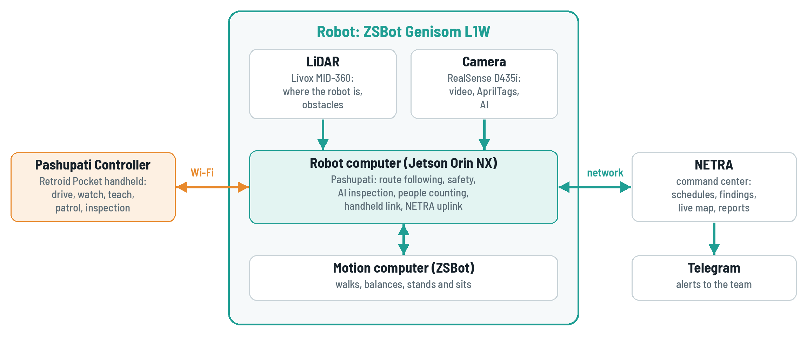{: .diagram}

| Part | What it is |
|---|---|
| Genisom L1W | the robot: walks and rolls on four legs with wheels |
| Robot computer | an NVIDIA Jetson on the robot that runs Pashupati |
| LiDAR | the laser scanner on top: tells the robot where it is and what is around it |
| Camera | Intel RealSense: video for you, AprilTags and the AI inspection |
| Pashupati Controller | the app on the Retroid Pocket handheld you hold |
| NETRA | the command center in the office: schedules, findings, reports |

## How a patrol works

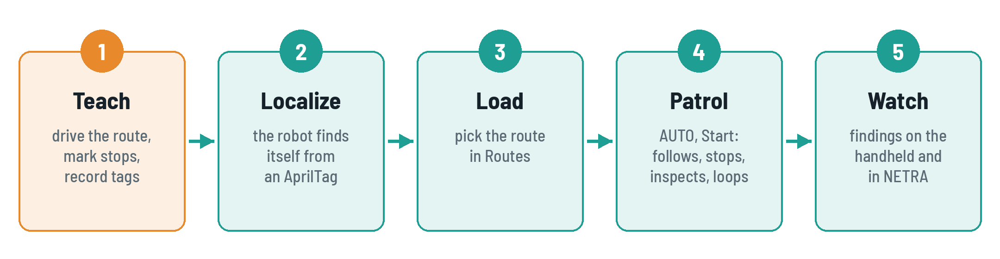{: .diagram}

## Words you will see

| Word | Meaning |
|---|---|
| AUTO | the robot drives itself along the loaded route |
| REMOTE | you drive the robot with the handheld's sticks |
| Route | a path you recorded once; the robot repeats it |
| Stop point | a place on the route where the robot stops and inspects |
| AprilTag | a printed black-and-white square on a wall; the robot uses it to know where it is |
| Localize | the robot works out where it is on the map, usually from an AprilTag |
| Inspection | the AI looks at the floor in the camera image |
| Finding | something the AI reported, for example *Trash* |
| E-stop | the emergency stop (STOP button) |

# Getting ready

## Power on

1. Insert a charged battery and switch the robot on, as described in the ZSBot manual. The
   robot stays down while it starts.
2. Wait about two minutes. The robot computer starts Pashupati by itself.

!!! note
    Right after power-on the robot computer waits up to one minute for its clock to be set
    over the network. Give it that time before you start a patrol.

## Connect the handheld

1. Switch on the Retroid Pocket and connect it to the robot's Wi-Fi network. Your technician
   tells you its name and password.
2. Open the **Pashupati** app. The start screen looks for robots on the network.
3. Tap **Main robot**, or the robot's name in the list once it is found.
4. The main screen opens (chapter 4).

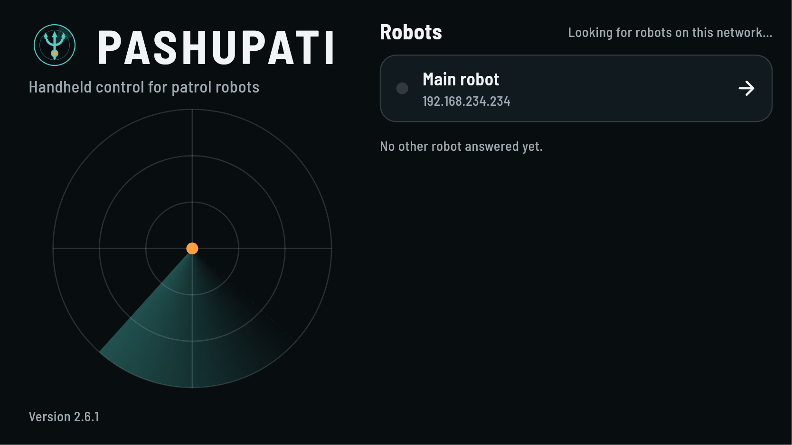

| The app says | What to do |
|---|---|
| The robot does not answer | check that the handheld is on the robot's Wi-Fi; wait until two minutes after power-on; check the robot address (next section) |
| The robot rejected the token | the token in the app differs from the robot's: see the next section |
| Another handheld is driving this robot | close the app on the other handheld |

## First-time setup

You only do this once per handheld, or when your technician gives you new details.

1. On the start screen, tap the version text at the bottom left three times quickly.
2. Enter the **Robot address** (`192.168.234.234` unless your technician says otherwise), the
   **Port** (`9870`) and the **Token**.
3. Give the handheld a name, for example *Retroid Security 1*, so others can see who drives.
4. Tap **Save**, then go back.

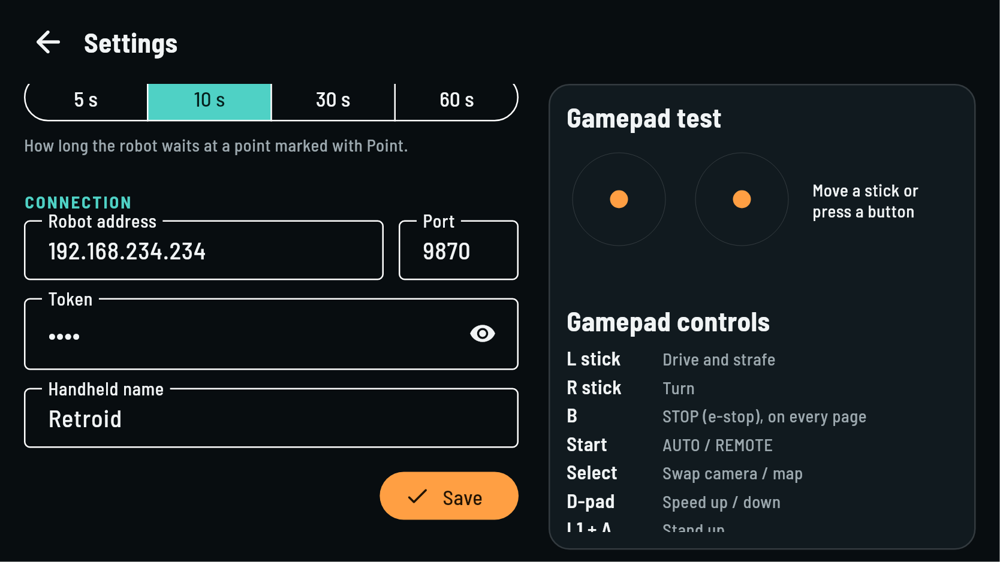

## Stand the robot up

1. Make sure there is at least 1 m of free space around the robot.
2. Tap **Stand up** in the robot actions on the right, or hold <kbd>L1</kbd> and press
   <kbd>A</kbd>.
3. Wait until the robot stands still.

!!! note "The robot ignores the handheld"
    After someone used the ZSBot remote, the robot may listen only to that remote. Tap
    **Take control** in the robot actions to give control back to the handheld.

# The Pashupati Controller

## The main screen

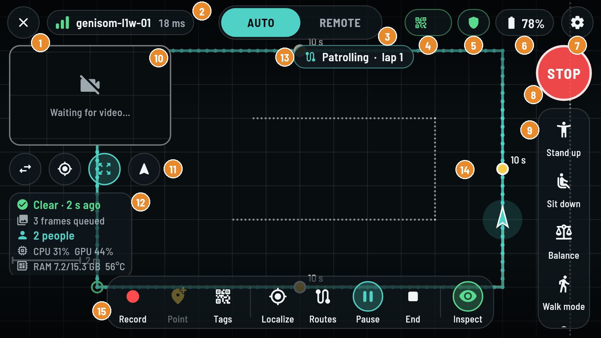

| | Part | What it shows or does |
|---|---|---|
| <span class="call">1</span> | Disconnect | leaves the robot and goes back to the start screen |
| <span class="call">2</span> | Link | robot name, signal bars and delay; red when the Wi-Fi link is weak |
| <span class="call">3</span> | AUTO / REMOTE | who drives: the robot (AUTO) or you (REMOTE) |
| <span class="call">4</span> | Localization | how the robot knows where it is: *Tag*, *Start pose*, *Pose*, or *No loc* in red |
| <span class="call">5</span> | Protective field | green shield: path clear; yellow: slowed for an obstacle; red: blocked or no scan |
| <span class="call">6</span> | Battery | robot battery level |
| <span class="call">7</span> | Settings | speed level, video, language and more (section 4.4) |
| <span class="call">8</span> | STOP | the emergency stop (section 1.3) |
| <span class="call">9</span> | Robot actions | stand up, sit down, balance, walk mode, gears, take control, motor stop |
| <span class="call">10</span> | Small view | the camera or the map; tap it to swap the two views |
| <span class="call">11</span> | View buttons | swap views, follow the robot, show the whole route, turn the map with the robot |
| <span class="call">12</span> | At a glance | last AI result, frames waiting, people in view, the robot computer's load |
| <span class="call">13</span> | Patrol status | what the robot is doing now (section 7.5) |
| <span class="call">14</span> | Map | the route in teal, stop points in yellow, the robot as an arrow |
| <span class="call">15</span> | Toolbar | teach (Record, Point, Tags), patrol (Localize, Routes, Start, End), Inspect |

The map can be moved with your fingers: pinch to zoom, drag to look around, twist with two
fingers to turn it. Double-tap to follow the robot again.

## Status chips

| Chip | Shows | Means |
|---|---|---|
| Localization | *Tag base_map* | the robot found itself from that AprilTag |
| | *Start pose* | the robot uses its start position as the map origin |
| | *Pose* | someone set the position by hand on a computer |
| | *No loc* (red) | the robot does not know where it is: tap **Localize** |
| Protective field | *Path clear* | nothing in the way |
| | *Slowed* | the robot slows down for something near its path |
| | *Blocked* | something is too close: the robot holds still |
| | *No scan* | the laser scanner is not reporting: the robot will not drive itself |
| Health | *Needs attention* | something is wrong on the robot: tell your technician |

## Gamepad buttons

| Button | Action |
|---|---|
| Left stick | drive forward, back and sideways (REMOTE) |
| Right stick | turn (REMOTE) |
| <kbd>B</kbd> | STOP, on every page |
| <kbd>Start</kbd> | switch AUTO / REMOTE |
| <kbd>Select</kbd> | swap camera and map |
| D-pad up / down | speed level up / down |
| <kbd>L1</kbd> + <kbd>A</kbd> | stand up |
| <kbd>L1</kbd> + <kbd>Y</kbd> | sit down |
| <kbd>R1</kbd> (held) | drive, only when *Hold R1 to drive* is on in the settings |

## Settings

Tap the gear at the top right. Changes apply at once.

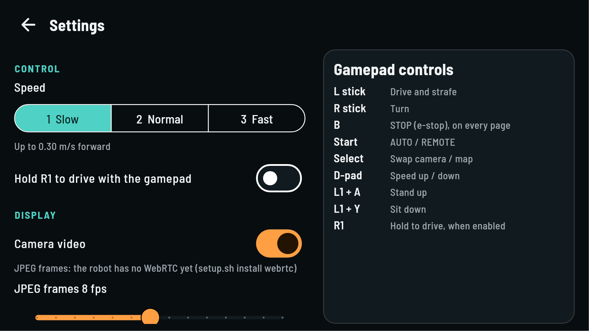

| Setting | What it changes |
|---|---|
| Speed | 1 Slow, 2 Normal, 3 Fast: 30, 60 or 100 % of the robot's top speed when you drive |
| Hold R1 to drive | the sticks only drive while <kbd>R1</kbd> is held (a dead-man switch) |
| Camera video | video from the robot camera on or off |
| Lidar points on the map | shows the walls and objects the scanner sees |
| Robot CPU, GPU and RAM on screen | the load lines in the *At a glance* panel |
| Language | English or Indonesian |
| Inspection at a stop point | how long the robot waits at a point you mark with **Point** |

# Driving by hand (REMOTE)

1. Make sure the robot stands and the area around it is clear.
2. Tap **REMOTE** at the top, or press <kbd>Start</kbd>.
3. Drive with the left stick (forward, back, sideways) and turn with the right stick.
4. Change the speed level with the D-pad, up for faster and down for slower.
5. To hand the robot back to the patrol, tap **AUTO** or press <kbd>Start</kbd> again.

!!! warning
    In REMOTE the robot does **not** slow down for obstacles. It goes exactly where you steer
    it. Drive slowly near people and start with speed level 1.

!!! note
    In AUTO the sticks do nothing. The app reminds you: *AUTO mode: switch to REMOTE to drive*.

# Teaching a route

## Plan the route

- Walk the route first and decide where the robot should stop and inspect.
- For a patrol that repeats on its own, end the route within 1 m of where it started. The
  robot then loops it.
- Fix AprilTags on walls along the route, at about the camera's height, and note their places.
  Your technician sets which tag numbers the robot uses.
- Avoid passages narrower than about 1.2 m (the robot has no room there to pass obstacles),
  glass walls, and every drop (section 1.1).

## Record the route

1. Stand the robot at the start of the route and switch to **REMOTE**.
2. Tap **Record**. The app shows *Recording a route* and the button changes to **Finish**.
3. Drive the route slowly and smoothly. The robot remembers its path.
4. At each place where it should inspect, stop and tap **Point**. The app shows
   *Stop point, inspect 10 s* (the time comes from the settings).
5. At the end of the route, tap **Finish**. The app shows *Route saved*. The route is also
   sent to NETRA.

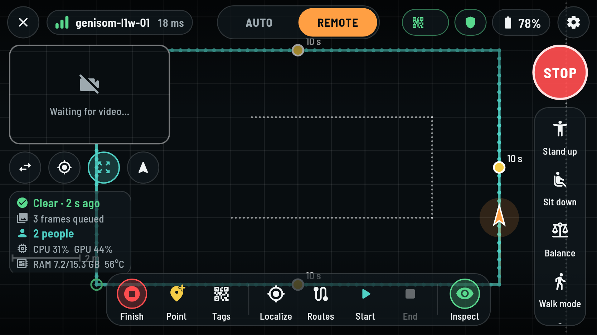

!!! tip
    Do not worry about small wobbles while driving. The robot smooths the route by itself, and
    stop points always stay exactly where you marked them.

## Record the AprilTags

Do this in the same session as the route, so the tags and the route share one map.

1. Drive the robot to where its camera sees an AprilTag well, about 1 to 2 m from it.
2. Hold still and tap **Tags**. The app shows *Tags recorded*.
3. Repeat for every tag along the route.

# Running a patrol (AUTO)

## Localize

The robot must know where it is before it may drive itself. Look at the localization chip at
the top.

- *Tag ...* or *Start pose*: the robot knows where it is.
- *No loc* in red: turn the robot so its camera sees an AprilTag and tap **Localize**.

The robot also localizes by itself when it sees a known tag after start-up.

## Load a route

1. Tap **Routes**. The list shows every recorded route by date and time.
2. Tap the route to patrol. The app goes back to the main screen and shows the route on the
   map.

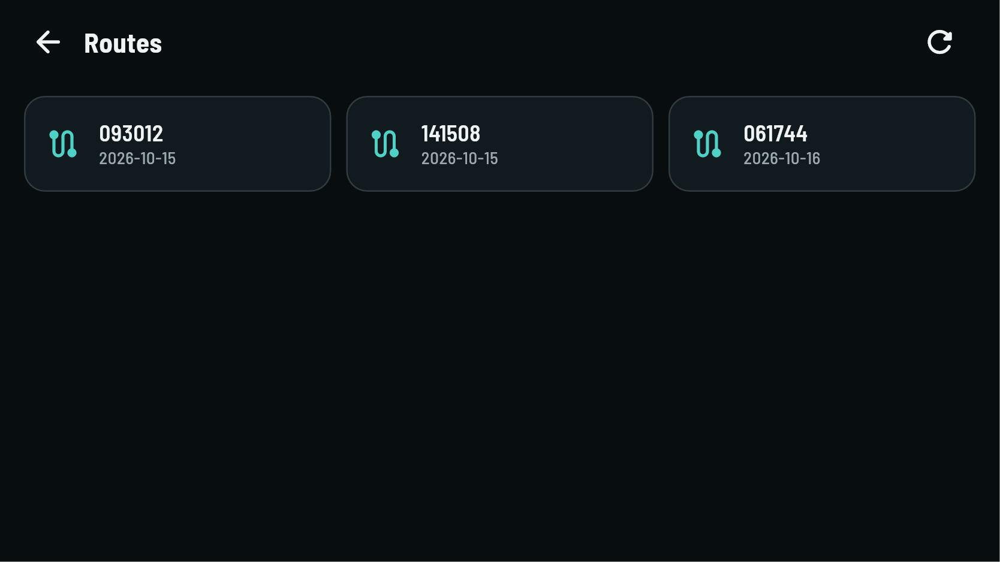

## Start, pause, resume and end

1. Check that the robot stands, is localized, and is near the route (closer than 3 m).
2. Tap **AUTO**, or press <kbd>Start</kbd>.
3. Tap **Start**. The status shows *Patrolling*. If the robot was beside the route, it first
   walks onto it (*Walking onto the route*).
4. **Pause** holds the robot where it is. **Resume** continues.
5. **End** finishes the patrol. The robot stops and stands.

!!! note
    You can also tap **Start** in REMOTE. The patrol then begins as soon as you switch to AUTO.

## What the robot does on its own

- **Follows the route** at the patrol speed (section 8.7), slower in tight bends.
- **Stops at each stop point**, turns to the recorded direction, waits for the AI to inspect,
  stays for the stop time, then walks on.
- **Passes obstacles** by sliding sideways, at most 0.8 m away from the route. When there is no
  gap, it stops about 0.4 m before the obstacle and waits.
- **Slows down and stops** for anything in its path, in every direction (the protective field).
- **Loops** a route that ends near its start, lap after lap.
- **Goes home at low battery**: when the battery is low, it ends the patrol at the end of the
  current lap (20 % unless your technician changed it).

## Patrol status

| Status | Meaning | What to do |
|---|---|---|
| Idle | no patrol running | load a route and tap **Start** |
| No route loaded | there is no route to follow | tap **Routes** and pick one |
| Waiting for localization | the robot does not know where it is | tap **Localize** in view of a tag |
| Walking onto the route | it walks from beside the route onto it | wait |
| Patrolling | following the route; the lap number is shown | watch |
| Approaching a stop | aligning on a stop point | wait |
| Inspecting | the AI looks at the floor at the stop point | wait |
| Blocked | something is in the way for a while | clear the way; it continues by itself |
| Off the route | the robot is more than 1.5 m from the route | drive it back in REMOTE, then AUTO and **Start** |
| Sensors stale | a sensor stopped reporting | stop the patrol, call your technician |
| Paused | paused by you, NETRA or after an e-stop | tap **Resume** when it is safe |
| Emergency stop | STOP is engaged | release it, then **Resume** |
| Route finished | an open route is done | tap **Start** for another run |

## Emergency stop during a patrol

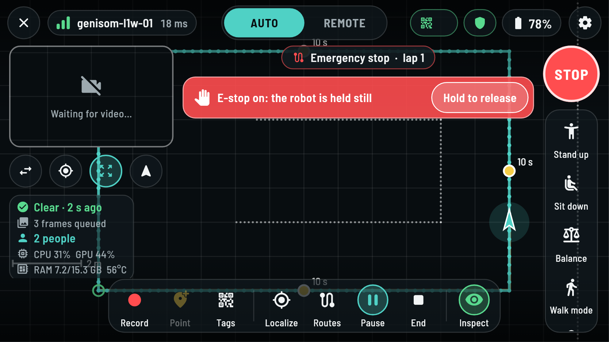

1. Press **STOP** or <kbd>B</kbd>. The robot stands still and the screen turns red.
2. Make the area safe.
3. Hold **Hold to release** for one second. The patrol stays paused.
4. Tap **Resume** to continue the patrol.

# AI inspection and people counting

## The Inspection page

Tap **Inspect** at the right end of the toolbar. The page shows the AI's state, its pace and
model, the people counter and the patrol speed.

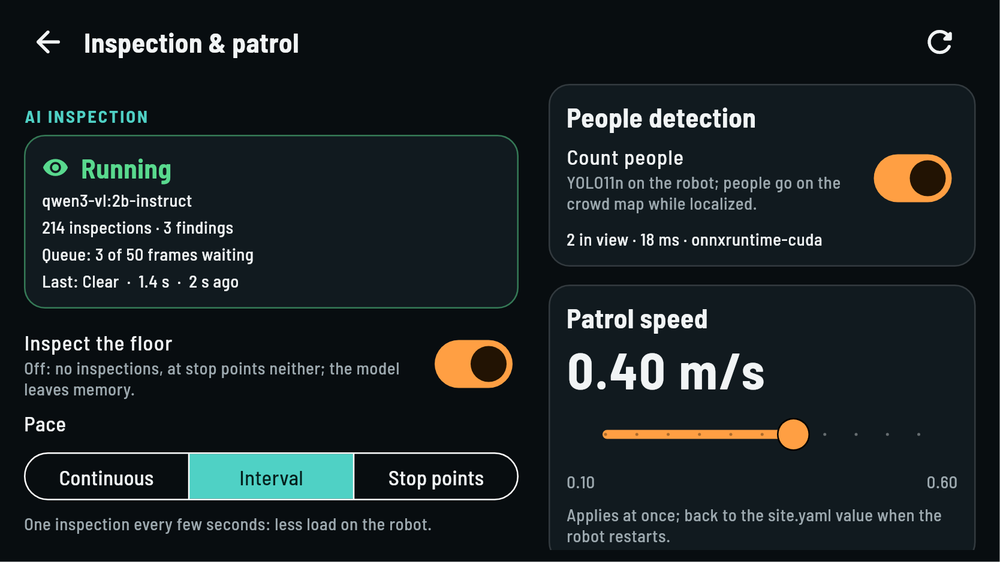

The status box shows:

- the state: *Running*, *Loading the model…*, *Off*, *Error*, or *Not responding*;
- the AI model in use;
- how many inspections and findings there were since the robot started;
- the queue, in interval pace (section 8.3);
- the last result and how long ago it was.

## Inspection on or off

Use the **Inspect the floor** switch. When it is off, the robot does not inspect, not even at
stop points, and the AI model is unloaded to free the robot's memory. Turning it on again takes
a few seconds while the model loads.

## Pace

| Pace | The robot inspects | Good for |
|---|---|---|
| Continuous | one image right after the other, all the time | the most thorough patrol |
| Interval | one image every few seconds (slider: 0.1 s to 5 min) | a lighter load on the robot |
| Stop points | only at the stop points of the route | inspecting chosen places only |

In **Interval** pace the robot takes an image at every interval, even while the AI is still
busy with an earlier one. The images wait in a queue and the AI works through them in the
order they were taken. The main screen shows *3 frames queued* while images are waiting. Each
finding is reported with the time and place where its image was taken.

!!! tip
    One inspection takes the AI about 1 to 2 seconds (shown on the page). With a shorter
    interval the queue fills up and the oldest images are dropped. When the robot stands still,
    identical images are not queued twice.

## AI model

The **Model** list shows the AI models on the robot. *In use* marks the active one, and *Ready
on the robot* marks models you can switch to. Tap a model to switch. The status shows *Loading
the model…* for a few seconds. A model marked *Not pulled yet* must first be installed by your
technician.

## Finding types

The **Finding types** list says what the AI looks for. Each type has a description that the AI
reads with every image.

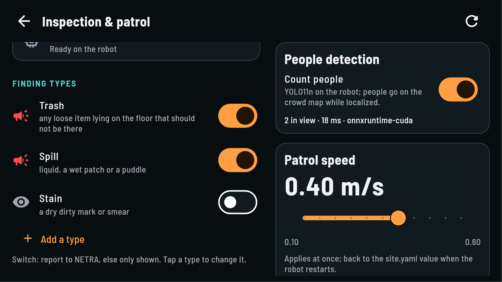

- The **switch** of a type: on means a finding of this type is **reported to NETRA**; off
  means it is only shown on the handheld. *Stain* is off by default, because shiny floors and
  reflections are easily taken for stains.
- **Tap a type** to change its description or to delete it.
- **Add a type** creates your own type.

To add a type:

1. Tap **Add a type**.
2. Enter a name, for example *unattended bag*. The app turns it into `unattended_bag`.
3. Describe what the AI should look for, in plain **English**, for example *a bag, backpack or
   suitcase standing alone on the floor*. Short, concrete descriptions work best.
4. Choose **Report to NETRA**, then tap **Save**.

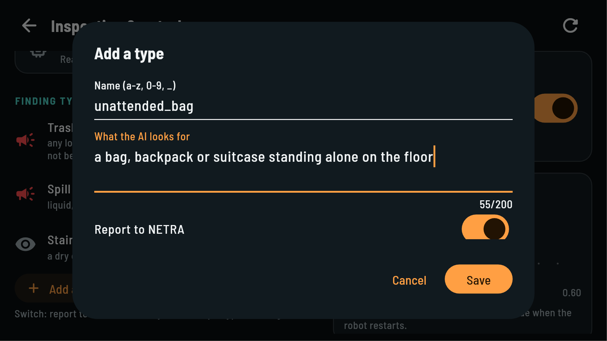

The robot keeps up to 12 types and remembers them after a restart.

## People counting

The **Count people** switch turns person detection on or off. While it is on:

- the main screen shows how many people are in view;
- people are boxed on the camera video;
- NETRA receives where people were, for its crowd map.

## Patrol speed

The **Patrol speed** slider sets how fast the robot walks its route, in metres per second. It
applies at once. After a restart of the robot it goes back to the speed your technician set.

## Results on the main screen

The *At a glance* panel under the small view shows the latest results without opening the
Inspection page:

| Line | Example | Means |
|---|---|---|
| AI result | *Clear · 2 s ago* (green) | the floor was clean in the last image |
| | *Trash · 12 s ago* (red) | a finding that was reported to NETRA |
| | *Stain · 5 s ago* (yellow) | a finding that is only shown |
| Queue | *3 frames queued* | images waiting for the AI (interval pace) |
| People | *2 people* | people in the camera view now |
| Load | *CPU 31 % GPU 44 %*, *RAM 7.2/15.3 GB 56 °C* | the robot computer's load; red near the limit |

Each new finding also shows a short message, *Finding: Trash*, with a vibration. Tap the panel
to open the Inspection page.

# NETRA command center

NETRA is the command center that runs in the office. Your technician connects the robot to
it. Through NETRA the team:

- sees every robot on a live map with its battery and status;
- starts patrols, now or on a weekly schedule, and can pause or stop them;
- receives findings with the photo the AI saw, the time and the place on the map;
- gets alerts in Telegram groups;
- sees crowd maps from the people counter.

Routes you record on the handheld are uploaded to NETRA automatically. If the robot loses its
network, it keeps patrolling and sends its findings once it is back online.

# After the shift

## Park and switch off

1. Tap **End** to finish the patrol.
2. Switch to **REMOTE** and drive the robot to its parking place.
3. Tap **Sit down**, or hold <kbd>L1</kbd> and press <kbd>Y</kbd>.
4. Tap the disconnect button at the top left.
5. Switch the robot off and charge its battery, as described in the ZSBot manual.
6. Charge the handheld.

## Daily checklist

| When | Check |
|---|---|
| Before | the route is clear, dry and has no drops |
| Before | robot battery at least 30 %, handheld charged |
| Before | the ZSBot remote is at hand |
| Before | the app connects; the link is green; the localization chip shows *Tag* |
| Before | the protective field shows *Path clear* |
| Before | the Inspection page shows *Running* if the patrol should inspect |
| During | the handheld stays with you; STOP is within reach |
| After | the patrol is ended, the robot sits, its battery is charging |
| After | findings that need cleaning are passed on to the cleaning team |

# Troubleshooting

Find the problem in the first column. Call your technician whenever the robot behaves in a way
this manual does not explain.

| Problem | Likely cause | What to do |
|---|---|---|
| The app does not find the robot | the robot is still starting, or the handheld is on another Wi-Fi | wait two minutes after power-on; connect the handheld to the robot's Wi-Fi |
| *The robot rejected the token* | wrong token in the app | enter the token from your technician (section 3.3) |
| *No gamepad found* | the app does not see the handheld's controls | close and reopen the app |
| The robot does not move with the sticks | AUTO mode, STOP engaged, the robot is sitting, or the ZSBot remote has control | switch to REMOTE, release STOP, tap **Stand up**, tap **Take control** |
| *No loc* in red | the robot does not know where it is | turn it towards an AprilTag and tap **Localize** |
| **Start** does nothing, or *robot is … m from the route* | not localized, no route loaded, or more than 3 m from the route | localize, load the route, drive the robot next to the route |
| *Off the route* | pushed or blocked far from the route | drive it back to the route in REMOTE, then AUTO and **Start** |
| *Blocked* for a long time | something stays in the way | clear the way, or end the patrol and drive around it |
| Video stays black | Wi-Fi is weak, or the camera is off | move closer; check *Camera video* in the settings |
| Inspection shows *Error* or *Not running* | the AI is not running on the robot | tell your technician |
| *Sensors stale* or *No scan* | the laser scanner stopped | end the patrol, sit the robot down, call your technician |
| *Needs attention*, or red CPU, GPU or RAM | the robot computer has a problem | finish the lap, then tell your technician |


# For the technician

## Addresses and ports

| What | Address |
|---|---|
| Robot computer (Jetson, Pashupati) | `192.168.234.234`, SSH user `robot` |
| Handheld link (teleop and discovery) | UDP `9870` on the robot computer |
| Video for the handheld (WebRTC) | TCP `8890`, UDP `8190` |
| Robot motion computer (ZSBot SDK) | `192.168.234.1`, UDP `8081` / `8080` |
| LiDAR (Livox MID-360) | `192.168.123.20`; robot computer `192.168.123.19` on that cable |
| AI models (Ollama) | `127.0.0.1:11434`, on the robot only |

## Service commands

```bash
ssh robot@192.168.234.234
sudo systemctl restart pashupati   # restart the stack
journalctl -fu pashupati           # follow its log
pashu                              # ROS shell of the stack
ros2 topic echo --once /health/status
```

## Configuration

| File | Holds |
|---|---|
| `/etc/pashupati/pashupati.env` | the deployment: robot package, NETRA address and token, extras |
| `/etc/pashupati/site.yaml` | parameters of this robot and site, see the Tuning Guide |
| `~/dev/Pashupati/map/<date>/` | recorded routes |
| `~/dev/Pashupati/map/tag_config.json` | AprilTag positions on the map |

Restart the service after changing either file in `/etc/pashupati`.

## Update

```bash
cd ~/dev/Pashupati && git pull && git submodule update --init --recursive
script/setup.sh install build config service && sudo systemctl restart pashupati
```

The handheld app is updated by installing a new APK from the PashupatiController repository.

# Quick card {: .keep }

| To | Do |
|---|---|
| Stop the robot now | **STOP** or <kbd>B</kbd>; release: hold **Hold to release** |
| Stand up / sit down | **Stand up** / **Sit down**, or <kbd>L1</kbd>+<kbd>A</kbd> / <kbd>L1</kbd>+<kbd>Y</kbd> |
| Drive by hand | **REMOTE** (<kbd>Start</kbd>), left stick moves, right stick turns |
| Faster / slower | D-pad up / down |
| Teach a route | REMOTE, **Record**, drive, **Point** at stops, **Finish** |
| Record tags | stand in view of a tag, **Tags** |
| Patrol | **Localize**, **Routes** → pick, **AUTO**, **Start** |
| Pause / continue / end | **Pause** / **Resume** / **End** |
| Inspection settings | **Inspect** |
| Robot ignores the handheld | **Take control** |
| Swap camera and map | tap the small view, or <kbd>Select</kbd> |
